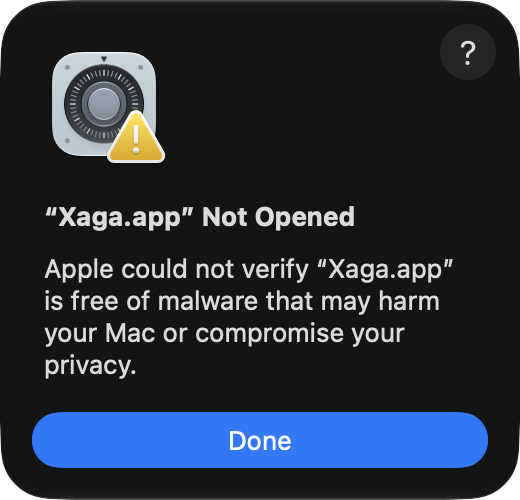
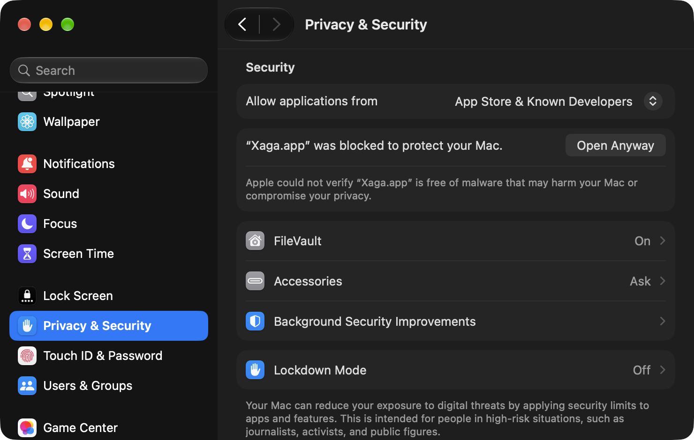
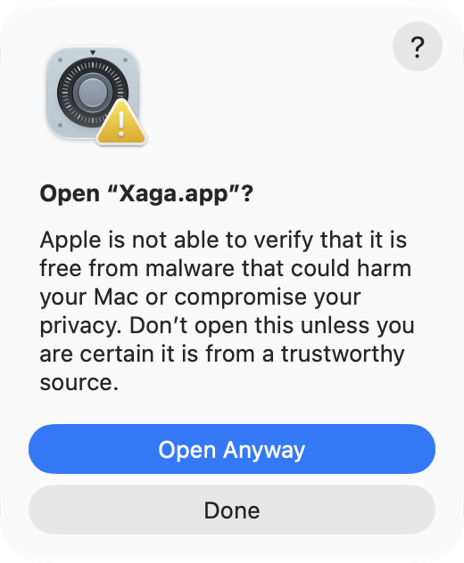

# Installing Xaga

Xaga currently supports Apple Silicon Macs. Intel Macs are not supported.

Download the latest appropriate build from the repository's
[GitHub Releases](https://github.com/reedable/xaga/releases) page. Do not open
Xaga until you have verified the download and completed the steps below.

## Recommended: verify and open from Terminal

Xaga's macOS releases carry an ad-hoc signature so macOS can verify that the
application bundle is internally consistent. They are not signed with an
Apple Developer ID or notarized through Apple's paid Developer Program.

Follow this procedure before launching Xaga:

1. On the GitHub release page, expand **Assets** and note the `sha256:` value
   shown beside the Xaga disk image.
2. In Terminal, calculate the downloaded disk image's SHA-256 digest. Type
   `shasum -a 256 ` (including the trailing space), drag the downloaded `.dmg`
   from Finder into Terminal, and press Return.
3. Compare the complete value printed by `shasum` with the value on GitHub.
   Do not continue if they differ.
4. Open the disk image and copy **Xaga.app** to a writable folder you control.
   Choose **Applications** only if you have already decided to install Xaga
   there; that location does not establish that an application is safe.
5. In Terminal, type the following command supplying your own path to Xaga.app.

   ```sh
   xattr -dr com.apple.quarantine /path/to/Xaga.app
   ```

6. Open that copy of Xaga.

Removing `com.apple.quarantine` bypasses Gatekeeper's first-launch review for
that specific copy. Do this only after confirming its source and SHA-256
digest. The command does not grant trust to other applications.

We recommend this workflow because the GUI-only Gatekeeper workflow described
below became stuck during testing. Running `xattr` before the first launch
avoids entering that workflow.

## Supplemental: the GUI-only Gatekeeper workflow

The normal macOS workflow for an unnotarized application does not require
Terminal:

1. Open Xaga. macOS displays an **“Xaga.app” Not Opened** message:



2. Click **Done**.
3. Open **Apple menu → System Settings → Privacy & Security**, scroll down to
   **Security**, and click **Open Anyway** beside the Xaga message:



4. macOS displays a confirmation dialog with **Move to Trash**, **Open
   Anyway**, and **Done**:



5. The normal workflow is to click **Open Anyway** in that confirmation
   dialog and authenticate if prompted.

We do not currently recommend this workflow. During testing, the final **Open
Anyway** action became stuck: Xaga remained open without displaying a window,
and a subsequent attempt to remove its quarantine attribute with `xattr` also
became stuck. Because entering the GUI workflow can interfere with the CLI
fallback, use the recommended Terminal procedure before launching Xaga.

If you already entered the GUI workflow, click **Done** if the confirmation
dialog is still available and force-quit Xaga if it remains in the Dock. Do
not assume that repeatedly clicking **Open Anyway** will resolve the problem.

## Installing permanently

If you initially copied Xaga somewhere else, quit it and move that verified
copy into **Applications** after deciding to keep it. This gives the app a
stable location; it does not make the app trusted or safer.
