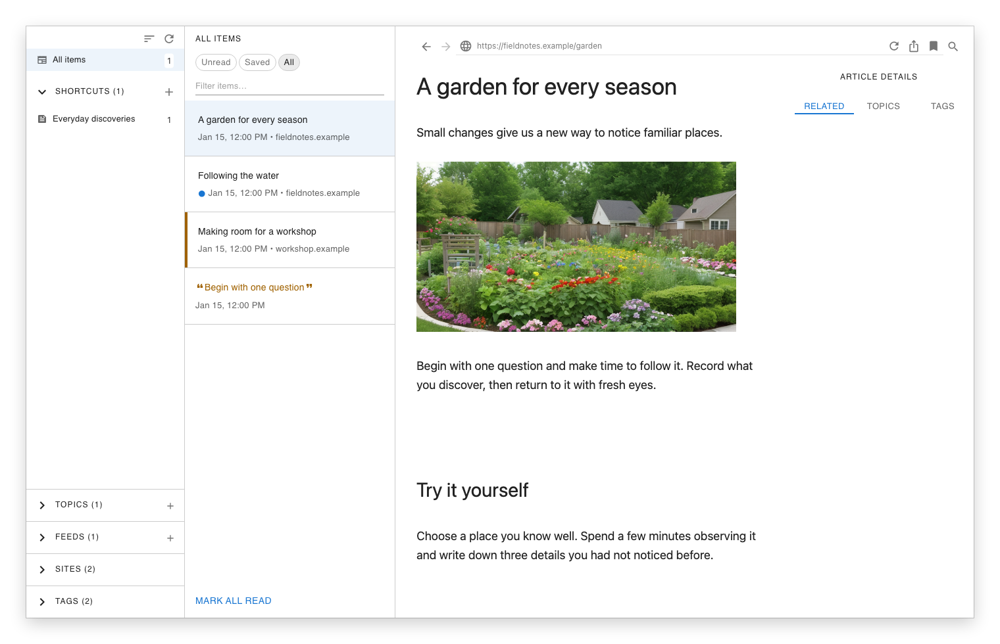
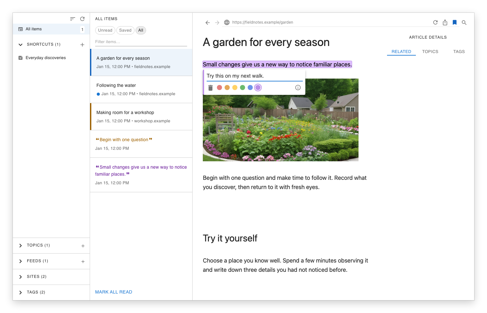
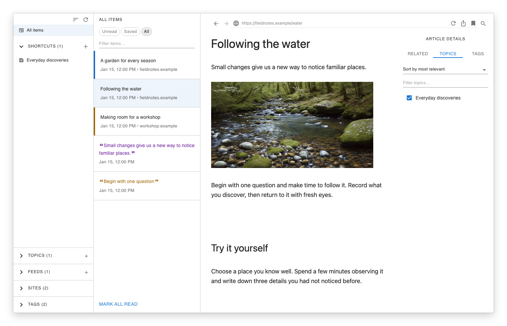
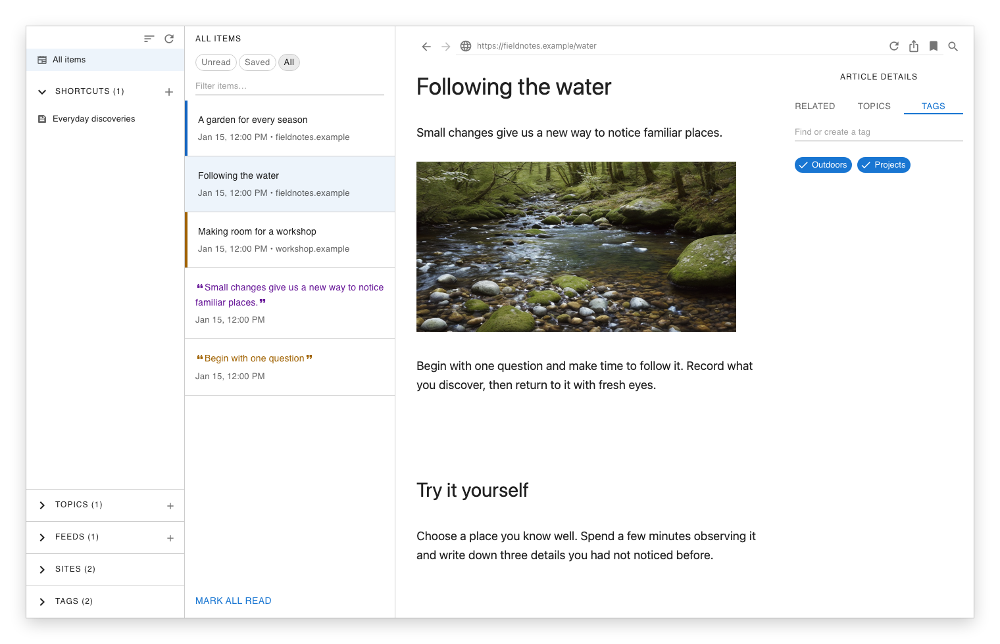

# Xaga User Guide

Use Xaga to follow feeds, read articles, and keep passages and ideas you want to
return to. This guide walks through those everyday tasks.

## Open your library

Follow the [installation instructions](installation.md), then choose **File →
Open Library** to select your library folder. See the
[library upgrade instructions](library_upgrade.md) when preparing a new folder
or opening a library from an older version. Opening a folder does not upgrade it.

A library that opens read-only shows an explanation before model startup. Choose
**Upgrade** for an older library or interrupted upgrade, or **Continue read-only**
to browse. The **Read-only** button in the sidebar reopens the explanation.
Back up the entire library folder and close other Xaga windows before upgrading.
To undo the upgrade, restore that backup. Keep Xaga open for progress and retry
feedback; after success it restarts and checks write access again.

For a newer library or upgrade target, **Upgrade Xaga** opens the releases page.
Invalid metadata and unavailable write access explain their causes without
an upgrade action. See the [upgrade guide](library_upgrade.md) for recovery.

The examples below use a small fictional library: **Field notes** is a feed,
**A garden for every season** and **Following the water** are articles, and
**Everyday discoveries** is a Topic.

## Add a feed

1. Click **Add feed**, the **+** beside **Feeds** in the sidebar.
2. Enter the feed's address in **URL**. Use the RSS or Atom feed address supplied
   by the website.
3. Optionally enter **Name (optional)** and select **Add to Shortcuts** if you
   want quick access to the feed.
4. Click **Add**, then select the feed to browse its articles.

If feeds fail to refresh, a notification shows the number of failures. Choose
**Details** to read each feed’s name and failure reason. The list scrolls, and the
notification stays until you dismiss it. Use **Refresh** to try again.

## Find and read an article

Choose a feed, or choose **All items** at the top of the sidebar to browse across
your library. Click **All** to include material you have already read; **Unread** shows
articles you have not read yet. Type in **Filter items…** to narrow the current
list, then click an article to open it in the reading pane.

<picture>
  <source media="(prefers-color-scheme: dark)" srcset="images/user-guide/reading-dark.png">
  
</picture>

Opening an article marks it as read. To change that status, open **Share** in the
reading pane's toolbar and choose **Mark as unread** or **Mark as read**. The
unread counts beside collections update. An article can stay in the open list
until you change views or filters, so reading does not make your place disappear.

Use **↑** and **↓** while an article in the list has keyboard focus to move
between articles. In a narrow window, use **Browse collections and tags** above
the list to navigate when the sidebar is hidden.

## Bookmark an article

1. With an article open, click **Add bookmark** in the reading pane's toolbar.
2. Choose a color. For example, choose blue for something you want to revisit.
3. Choose **All items**, then **Saved**, to find your bookmarked articles and
   annotations together.

<picture>
  <source media="(prefers-color-scheme: dark)" srcset="images/user-guide/bookmark-dark.png">
  
</picture>

To change the color, click **Change bookmark color**. To remove the bookmark,
click **Remove marking**, then **Remove**. This keeps the article in your library.

## Keep a passage and a comment

1. Select text in the reading pane.
2. Choose a highlight color in the palette that appears.
3. If you want to add a comment, type in **Add a note…**, then click outside the
   annotation controls to close them.

<picture>
  <source media="(prefers-color-scheme: dark)" srcset="images/user-guide/annotation-dark.png">
  
</picture>

The highlight and optional comment form an annotation. Choose **All items →
Saved**, then click the quoted passage in the list to return to its place in the
article. Click the highlight to edit its comment or color. **Remove marking**,
followed by **Remove**, removes the annotation.

## Group material in Topics

A Topic brings related articles and annotations together, even when they came
from different feeds.

1. To create a Topic, click **Add topic**, the **+** beside **Topics** in the
   sidebar. Enter a **Title**, optionally add a **Description**, and click **Save**.
2. Open an article and choose **Topics** in **Article details**. If the details
   panel is hidden, click **Show article details** in the toolbar first.
3. Select a Topic, such as **Everyday discoveries**, to add the article. Clear
   its checkbox to remove the article from that Topic.
4. Expand **Topics** in the sidebar and select the Topic to browse its members.
   Choose **All** if you also want to see read articles.

<picture>
  <source media="(prefers-color-scheme: dark)" srcset="images/user-guide/topics-dark.png">
  
</picture>

To organize an annotation, click its highlight and choose **Show annotation
details**, then use its **Topics** view.

## Browse by website or tag

Expand **Sites** and select a website to see articles you already have from
that website. Sites groups saved material; selecting a website does not subscribe
you to its feeds or fetch all its pages.

Tags give articles and annotations labels you choose:

1. Open an article and select **Tags** in **Article details**. To tag an
   annotation, click its highlighted passage, choose **Show annotation details**,
   and select **Tags** in **Annotation details**.
2. Click a tag to assign it; click it again to remove that assignment. For a new
   tag, type its name in **Find or create a tag**, then click **Create “name”**.
3. Expand **Tags** in the sidebar and select tags to browse matching articles and annotations.
   Each result must have every selected tag itself; tags on an article and its
   annotations are not combined. Selecting an annotation opens its passage.

<picture>
  <source media="(prefers-color-scheme: dark)" srcset="images/user-guide/tags-dark.png">
  
</picture>

Tag assignments save as you change them. Removing a tag from one article or
annotation keeps the tag available elsewhere. Tagging an annotation does not tag
its article or other annotations. Recoloring keeps its tags.

With tags selected, **Saved** includes matching annotations and bookmarked
articles. Clear the selection to return to All items under your current filters.
Deleting a tag removes its assignments from articles and annotations while
retaining that content; removing one chip assignment only affects its target.

## Sort and filter sidebar collections

Click **Sort and filter collections**, immediately left of **Refresh** at the top
of the sidebar. In the **Sort collections** dropdown, choose **Sort by unread** or
**Sort by name**. The same sorting choices are available in the macOS **View**
menu, beside **Show Sidebar**.

Type in **Filter collections** to narrow the sidebar lists. Closing the popup
keeps your filter active; a dot on the toolbar button indicates filtering. Open
it again to edit the filter or choose **Clear collection filter**. **All items**
remains available regardless of the collection filter.

Your choice applies to Shortcuts, Topics, Feeds, and Sites, including nested
shortcut groups, and is remembered when you reopen Xaga. Tags stay sorted by
name. Sorting is also available when your library is read-only.

## Keep a shortcut

For an open article, choose **Share → Add to Shortcuts**. For a feed or Topic,
select **Add to Shortcuts** when adding or editing it. Your shortcut appears
under **Shortcuts** in the sidebar.

Choose **Share → Remove from Shortcuts** to unpin an article. Removing a shortcut
keeps its destination and your current reading context.

## Adjust Settings

Open **Xaga → Settings…**. Settings are shared across your libraries on this
machine. Switches save immediately. Numeric fields save when you leave the field,
press Enter, or close Settings. Invalid input or a failed save keeps Settings
open; the input remains available for correction or retry.

### General

Use **Switch library** to choose another library folder. **Refresh all feeds on
start-up** automatically contacts subscribed websites when Xaga starts; a change
applies on the next start. **Show PDFs in the reading pane** chooses between the
reading pane and your default PDF app.

Under **Size limits**, **Maximum import file size** applies to feed and bookmark
import files (default 64 MiB). **Maximum feed response size** applies to each
fetched feed, edited in MiB (default 10 MiB), counting decompressed bytes
when compression is enabled. Larger limits allow larger inputs and can use more
memory. Changes apply to the next import or feed operation.

Under **Timeouts**, **Article load timeout** bounds article-loader operations,
including image recovery; **Feed request timeout** covers connection, response,
and body reading for each feed. Both default to 10 seconds. Longer timeouts give
slower websites more time but delay reporting failure. Changes apply to new
loader operations or the next feed add, refresh, or import. Feed size and timeout
fields retain their existing limits, including zero. Feed size accepts fractional
MiB that equal a whole number of bytes; timeouts accept whole seconds.

### Appearance

Under **Reading**, **Default article view** selects **Summary** or **Reader**.
The font, font size, and line height controls adjust the reading presentation.

### Privacy

**Send referring URLs for feed redirects** is off by default. Enabling it lets
redirect destinations learn the previous feed URL and may help feeds that
require it. **Allow compressed feed transfers** is also off by default. Enabling
it advertises gzip support to feed websites, revealing another client capability
in exchange for potentially smaller transfers. The feed size limit still counts
decompressed bytes. Both changes apply to the next feed add, refresh, or import;
they do not change article-loader headers or compression.

**Keep website sessions** lets listed websites retain cookies and site data in
isolated sessions, for example to stay logged in. Persistent sessions require
macOS 14 or later. Reopen existing loader windows after changing this list.
**Save article images for offline viewing** allows additional image requests;
its description explains when the change takes effect and which images remain
available when it is off.

### Security

**Allow unencrypted HTTP** is off by default. Enabling it allows HTTP requests
routed through Xaga’s proxy; traffic can be read and changed in transit.
**Allow HTTPS connections on other ports** is also off by default: CONNECT
tunnels are restricted to port 443. Enabling it permits tunnels to any port,
increasing the services a website can reach. Address checks still apply, but the
proxy cannot inspect traffic inside a tunnel. These changes apply to new proxy
requests or tunnels, leaving existing connections unaffected. These controls
cover feeds and article-loader requests that use the proxy; WebKit can bypass
the proxy for some local requests, so they do not govern all webview traffic.

**Maximum feed redirects** defaults to 3 and accepts 0–10. Zero refuses the first
redirect; higher values follow more website-selected destinations. Changes apply
to the next feed add, refresh, or import. This does not limit redirects in
article-loader windows.
